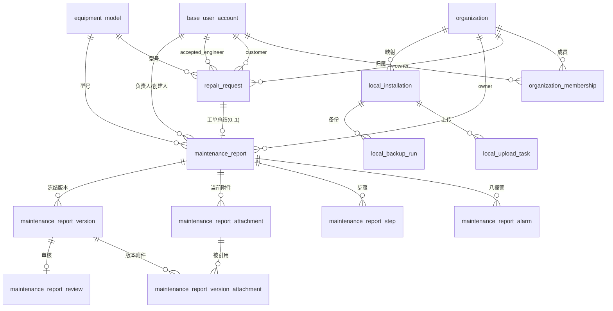

# 组织、维修报告与工单数据增量设计

- 初稿：2026-10-28；实现与交接整理：2026-10-29。
- 性质：供 PR 审核的设计依据与实现说明，尚不代表薛一审或负责人二审通过。
- 范围：在 PR0 的 24 条迁移、23 张业务表上追加 5 条迁移、10 张表，终态为 29 条迁移、33 张业务表。
- 依据：用户确认的组织与维修业务口径、[PR0 Schema 快照](./data-collection-schema.md)及仓库后端规则。
- 阅读方式：§1—§12 保留建模选择与字段设计；§14 明确实际实现与初稿的差异，涉及差异时优先核对该节以及当前 Entity / Migration / 用例，不把未实现的方案当作已交付功能。
- 操作与证据：[部署 SOP](./部署与增量升级SOP-20261029.md)、[验收记录](./organization-maintenance-data-increment-acceptance-20261029.md)。

## 0. 设计边界与原则

1. 保留存量 23 张业务表及 24 条迁移，只做**追加**：2 张表加列、10 张新表。不改已接受迁移，不回改 PR0 语义。
2. 所有写入由服务端可信上下文决定组织与角色，不接受客户端自报组织/角色/状态映射。
3. 组织归属“优先显式落点，子记录受约束派生”：报告、工单、正式资料持 `owner_organization_id`；报警、步骤、附件、版本、审核、AI 记录通过受约束父关系派生，不各自复制组织列。
4. 工作态用规范子表；冻结态用**严格版本化 JSON** 快照。二者不互相替代、不双写矛盾。
5. 未使用 AI 时不得伪造输出、评分或 0 分；历史数据不回填假评价。
6. 本地相关表只承载“部署身份、上传意图/回执、备份清单”，不复制云端业务主键。
7. 业务日期用 `DATE`，事件时间用 `TIMESTAMP(3)`，无默认“今天”；金额/大小用无符号整型。

## 1. 方案比较与裁定（不机械增加表）

### 1.1 报告内容：规范子表 vs 严格版本化 JSON

| 维度            | A. 全部子表          | B. 全部 JSON       | C. 工作态子表 + 冻结态 JSON（推荐）                    |
| --------------- | -------------------- | ------------------ | ------------------------------------------------------ |
| 八报警/步骤约束 | 可 CHECK、可唯一     | 只能应用层校验     | 草稿可 CHECK，冻结由 schema v2 校验                    |
| 按报警码检索    | 可索引               | 需生成列/JSON 索引 | 草稿低频检索可接受；冻结态不需检索                     |
| 冻结不可变      | 需复制整表           | 天然快照           | 天然快照                                               |
| 历史版本回看    | 多表 join + 版本标记 | 单行读取           | 单行读取                                               |
| 与 PR0 一致性   | 偏离                 | 偏离               | 与 `content_submission_revision.payload_snapshot` 一致 |
| 迁移/回滚成本   | 高                   | 低                 | 中                                                     |

**推荐 C**。理由：草稿需要“重排不串号、八项报警唯一、步骤编码唯一”等 DB 约束；冻结后无需再编辑，只需整体读取与不可变证据，JSON 快照最合适。JSON 用 `schema_version=2` 严格 schema（`additionalProperties=false`），v1 空扩展位保持原样不扩键。

### 1.2 工单总结是否复用 `content_submission`

| 维度     | A. 复用投稿表（新增 kind）                                        | B. 独立 `maintenance_report`（推荐）   |
| -------- | ----------------------------------------------------------------- | -------------------------------------- |
| 状态机   | 复用 PUBLISHED→reference_document                                 | 复用同一套 4 值词汇，但终止于 APPROVED |
| 语义     | “投稿”必须发布为正式资料，工单总结不发布                          | 语义纯粹                               |
| 约束改动 | 需改 content_submission/detail/revision 的 CHECK 与发布回链唯一键 | 新表自带约束，不动存量                 |
| 权限     | 投稿写权限=工程师；总结还要绑工单/负责人                          | 可独立定义                             |
| 迁移风险 | 触达 8 张既有表                                                   | 仅新增表                               |

**推荐 B**。复用“模式”而不复用“表”：`maintenance_report` + `maintenance_report_version` + `maintenance_report_review` 与投稿三件套同构，状态词汇同为 `DRAFT/PENDING_REVIEW/RETURNED/APPROVED`（投稿为 PUBLISHED），避免两套矛盾审批状态。

### 1.3 单有效组织归属

| 方案                                     | 并发安全       | 存量兼容          | TypeORM/MySQL 风险                                                  | 结论     |
| ---------------------------------------- | -------------- | ----------------- | ------------------------------------------------------------------- | -------- |
| A. 生成列 `active_account_id` + 唯一索引 | 是（DB 保证）  | ACTIVE 行原样保留 | MySQL 8 支持 STORED 生成列；TypeORM 需 `asExpression/generatedType` | **推荐** |
| B. 独立 `account_active_membership` 表   | 是             | 需迁移并保持双写  | 双写不一致风险                                                      | 备选     |
| C. 应用层行锁 + 触发器                   | 依赖每次写路径 | 无                | 触发器难维护、难测试                                                | 不采用   |

**推荐 A**：`active_account_id INT AS (IF(status='ACTIVE', account_id, NULL)) STORED` + `UNIQUE uk_organization_membership_active_account`。LEFT 行为 NULL，MySQL 唯一索引允许多 NULL，历史成员关系完整保留。

### 1.4 审核发布时的多附件选择

| 方案                                                                   | 约束完整性           | 读取成本    | 表数量 |
| ---------------------------------------------------------------------- | -------------------- | ----------- | ------ |
| A. `maintenance_report_version_attachment.publish_flag` 由审核事务写入 | 复合 FK 可保证同报告 | 单表 join   | 0 新增 |
| B. 独立 `review_attachment` 选择表                                     | 强                   | 多一次 join | +1     |
| C. review 行存 `published_attachment_ids` JSON                         | 无 FK，需应用校验    | 解析 JSON   | 0 新增 |

**推荐 A**：版本附件行在提交时已冻结，每版本至多一条审核，`publish_flag` 只允许在 APPROVE 事务中写入（其他写路径不存在），审核人/时间由 `maintenance_report_review` 承担。B 与 A 事实重复；C 失去引用完整性。

### 1.5 是否新增“组织字典 / 阶段字典 / 结果字典”表

不新增。阶段编码、五类结果、三种状态、AI 正确性取值均为**稳定受控枚举**，落在 Entity 类型 + GraphQL 枚举 + DB CHECK，标签映射在 `backend/src/types`，不支持后台改标签，避免字典表带来版本漂移。

## 2. ER 图



存量复用关系（不变）：`content_submission*` → `reference_document` → `reference_document_case_detail`；`repair_request` → `engineer_response` / `ai_conversation` → `ai_message` / `ai_report`。

## 3. 逐表逐字段字典

> 约定：`NN`=NOT NULL，`NULL`=可空，`DF`=默认值；所有时间列为 `TIMESTAMP(3)`，创建/更新沿用 `CURRENT_TIMESTAMP(3)` / `ON UPDATE`；`restrict` 外键均为 `ON DELETE RESTRICT ON UPDATE RESTRICT`。

### 3.1 改造表 A：`organization_membership`

| 字段                | 类型        | 空/默认          | 约束/说明                                                                                    |
| ------------------- | ----------- | ---------------- | -------------------------------------------------------------------------------------------- |
| `member_role`       | varchar(20) | NN               | **改**：CHECK 扩为 `('SUPER_ADMIN','ENGINEER','CUSTOMER')`                                   |
| `status`            | varchar(16) | NN DF `'ACTIVE'` | 不变：`ACTIVE/LEFT`                                                                          |
| `active_account_id` | int         | NULL             | **新增生成列** `AS (IF(status='ACTIVE', account_id, NULL)) STORED`，唯一索引承载“单有效组织” |

新增约束：`uk_organization_membership_active_account(active_account_id)`；新增索引 `idx_organization_membership_org_role_status(organization_id, member_role, status)`。存量唯一键 `(organization_id, account_id)`、期限 CHECK、外键全部保留。

### 3.2 改造表 B：`repair_request`

| 字段                              | 类型         | 空/默认         | 约束/说明                                                                                              |
| --------------------------------- | ------------ | --------------- | ------------------------------------------------------------------------------------------------------ |
| `owner_organization_id`           | int          | NULL（目标 NN） | 新增；`fk_repair_request_owner_organization`；新写入必填，存量按证据回填，未证据保持 NULL 并进异常清单 |
| `handling_result`                 | varchar(32)  | NULL/DF NULL    | 五类：`FIXED / PART_PURCHASED / PROVIDE_PLAN_SELF_EXECUTE / INTERRUPTED / UNREPAIRABLE`                |
| `handling_status`                 | varchar(16)  | NULL            | 三态：`COMPLETED / IN_PROGRESS / UNRESOLVED`，只能由服务端按固定映射写出                               |
| `handling_recorded_at`            | timestamp(3) | NULL            | 结果记录事件时间，非业务日期                                                                           |
| `handling_recorded_by_account_id` | int          | NULL            | `fk_repair_request_handling_recorder`，`base_user_account(id)`                                         |
| `handling_ended_at`               | timestamp(3) | NULL            | `COMPLETED/UNRESOLVED` 必填；`IN_PROGRESS` 必为 NULL                                                   |

新增索引：`idx_repair_request_owner_created(owner_organization_id, created_at)`、`idx_repair_request_owner_status(owner_organization_id, handling_status)`；新增唯一键 `uk_repair_request_id_owner(id, owner_organization_id)`：**当前仅作为“组织内工单”的稳定锚点与后续复合外键的预留索引，没有任何外键引用它**。`owner_organization_id` 实际只有单列外键 `fk_repair_request_owner_organization(owner_organization_id)→organization(id)`；该外键只保证组织存在，不保证子记录（报告等）与工单属于同一组织，跨组织一致性由用例在行锁后校验（见 §14 第 14 条）。

### 3.3 新表 1：`maintenance_report`（统一报告根）

| 字段                                 | 类型               | 空/默认            | 说明                                                                                                             |
| ------------------------------------ | ------------------ | ------------------ | ---------------------------------------------------------------------------------------------------------------- |
| `id`                                 | int unsigned AI PK | NN                 | —                                                                                                                |
| `owner_organization_id`              | int                | NN                 | `fk_maintenance_report_owner_organization`；组织隔离唯一真实落点                                                 |
| `source_type`                        | varchar(32)        | NN                 | `HISTORICAL_CASE / WORK_ORDER_SUMMARY`                                                                           |
| `repair_request_id`                  | int                | NULL               | 仅 `WORK_ORDER_SUMMARY` 必填；`fk_...`；`uk_maintenance_report_request` 唯一（一工单至多一份总结根）             |
| `title`                              | varchar(200)       | NULL（提交前必填） | 草稿可空，冻结前应用层校验                                                                                       |
| `customer_factory_name`              | varchar(100)       | NULL（提交前必填） | 客户厂家手填，独立字段，不据其匹配组织                                                                           |
| `equipment_model_id`                 | int                | NULL               | `fk_..._equipment_model`，全局型号库                                                                             |
| `equipment_model_text`               | varchar(100)       | NULL               | 型号文本快照；与 id 互斥（沿用 PR0 `model_exclusive` 模式）                                                      |
| `maintenance_date`                   | date               | NULL（提交前必填） | 业务日期，**不默认今天**                                                                                         |
| `maintenance_engineer_account_id`    | int                | NN                 | 负责人账号 `fk_..._engineer_account`                                                                             |
| `maintenance_engineer_name_snapshot` | varchar(50)        | NN                 | 负责人姓名快照，姓名变更不回写                                                                                   |
| `phase_flow_version`                 | smallint unsigned  | NN DF 1            | 阶段流程版本，决定阶段编码合法性                                                                                 |
| `status`                             | varchar(16)        | NN DF `'DRAFT'`    | `DRAFT/PENDING_REVIEW/RETURNED/APPROVED`                                                                         |
| `current_version_no`                 | int unsigned       | NN DF 0            | 最近冻结版本号                                                                                                   |
| `last_submitted_at`                  | timestamp(3)       | NULL               | 最近提交事件时间                                                                                                 |
| `last_reviewed_at`                   | timestamp(3)       | NULL               | 最近审核事件时间                                                                                                 |
| `ai_usage`                           | varchar(16)        | NN DF `'NOT_USED'` | `USED / NOT_USED`                                                                                                |
| `ai_source_type`                     | varchar(64)        | NULL               | 分析结果来源命名空间；`USED` 时必填，**不在 DB 写死未经确认的来源取值**（避免把演示表/未确认来源固化为正式方案） |
| `ai_source_id`                       | varchar(128)       | NULL               | 分析结果稳定标识（不建 FK，见 §9.3）                                                                             |
| `ai_source_version`                  | varchar(64)        | NULL               | 分析结果不可变版本/内容摘要                                                                                      |
| `ai_score`                           | tinyint unsigned   | NULL               | 1–5，禁止 0 代替“不适用”                                                                                         |
| `ai_correctness`                     | varchar(16)        | NULL               | `CORRECT / PARTIAL / INCORRECT`                                                                                  |
| `ai_helpfulness`                     | tinyint unsigned   | NULL               | 1–5                                                                                                              |
| `ai_note`                            | varchar(2000)      | NULL               | 文字评价                                                                                                         |
| `created_by_account_id`              | int                | NN                 | `fk_..._created_by`                                                                                              |
| `updated_by_account_id`              | int                | NN                 | `fk_..._updated_by`                                                                                              |
| `created_at` / `updated_at`          | timestamp(3)       | NN DF now          | —                                                                                                                |

约束：`uk_maintenance_report_request(repair_request_id)`（一工单至多一份总结根）、`uk_maintenance_report_id_owner(id, owner_organization_id)`（组织内报告锚点，当前无外键引用）；`owner_organization_id` 与 `repair_request_id` **各自为单列外键**（分别指向 `organization(id)`、`repair_request(id)`），数据库不做“报告组织 = 工单组织”的联合校验，该一致性由建稿用例在锁定工单后比对两者组织后写入（见 §14 第 14 条）。

### 3.4 新表 2：`maintenance_report_alarm`（初始八项报警）

| 字段                | 类型               | 空/默认 | 说明                                      |
| ------------------- | ------------------ | ------- | ----------------------------------------- |
| `id`                | int unsigned AI PK | NN      | —                                         |
| `report_id`         | int unsigned       | NN      | `fk_..._report`，级联限制删除             |
| `alarm_index`       | tinyint unsigned   | NN      | 1–8，固定槽位                             |
| `alarm_code`        | varchar(100)       | NN      | 报警代码原文（保留原大小写/格式）         |
| `alarm_description` | varchar(500)       | NULL    | 手工补充说明                              |
| `phase_code`        | varchar(32)        | NN      | 稳定阶段编码（10 阶段），标签在类型层     |
| `reset_result`      | varchar(16)        | NN      | `RESET_OK / RESET_FAILED / NOT_ATTEMPTED` |

约束：`uk_maintenance_report_alarm_slot(report_id, alarm_index)`、`chk_..._index CHECK(alarm_index BETWEEN 1 AND 8)`、`chk_..._reset_result`、`idx_maintenance_report_alarm_code(alarm_code)`。

### 3.5 新表 3：`maintenance_report_step`（排查步骤，工作态）

| 字段                  | 类型               | 空/默认 | 说明                                     |
| --------------------- | ------------------ | ------- | ---------------------------------------- |
| `id`                  | int unsigned AI PK | NN      | —                                        |
| `report_id`           | int unsigned       | NN      | `fk_..._report`                          |
| `step_no`             | smallint unsigned  | NN      | 顺序号，从 1 连续；重排两段式写（见 §8） |
| `step_code`           | varchar(64)        | NN      | 步骤稳定编码，不随排序变化               |
| `phase_code`          | varchar(32)        | NN      | 阶段编码                                 |
| `part_name`           | varchar(100)       | NULL    | 零件/部位                                |
| `action_text`         | text               | NN      | 动作                                     |
| `result_text`         | varchar(2000)      | NULL    | 结果                                     |
| `new_alarm_code`      | varchar(100)       | NULL    | 新故障分支对应报警代码原文               |
| `is_valid_new_branch` | tinyint(1)         | NN DF 0 | 有效新分支标记；非法组合由 CHECK 拒绝    |

约束：`uk_..._step_no(report_id, step_no)`、`uk_..._step_code(report_id, step_code)`、`chk_..._step_no CHECK(step_no>=1)`、`chk_..._branch CHECK(is_valid_new_branch=0 OR new_alarm_code IS NOT NULL)`、`idx_..._phase(report_id, phase_code)`。

### 3.6 新表 4：`maintenance_report_attachment`（当前附件集合）

| 字段                        | 类型               | 空/默认           | 说明                       |
| --------------------------- | ------------------ | ----------------- | -------------------------- |
| `id`                        | int unsigned AI PK | NN                | 本地附件标识，不当云端主键 |
| `report_id`                 | int unsigned       | NN                | `fk_..._report`            |
| `original_filename`         | varchar(255)       | NN                | 原文件名快照               |
| `mime_type`                 | varchar(100)       | NN                | 提交前已鉴定               |
| `byte_size`                 | bigint unsigned    | NN                | 单文件 ≤ 20 MiB            |
| `checksum_sha256`           | char(64)           | NULL              | 备份/上传对账用，可空      |
| `storage_backend`           | varchar(16)        | NN                | `LOCAL / OBJECT`           |
| `storage_reference`         | varchar(512)       | NN                | 本地相对路径或对象键       |
| `sort_order`                | smallint unsigned  | NN                | 1–10 展示顺序              |
| `description`               | varchar(500)       | NULL              | 附件说明                   |
| `status`                    | varchar(16)        | NN DF `'CURRENT'` | `CURRENT / RETIRED`        |
| `uploaded_by_account_id`    | int                | NN                | `fk_..._uploaded_by`       |
| `retired_at`                | timestamp(3)       | NULL              | 退役时间；RETIRED 必填     |
| `created_at` / `updated_at` | timestamp(3)       | NN DF now         | —                          |

约束：`uk_..._id_report(id, report_id)`（复合 FK 锚点）、`chk_..._byte_size CHECK(byte_size>0 AND byte_size<=20971520)`、`chk_..._sort_order CHECK(sort_order BETWEEN 1 AND 10)`、`chk_..._status`、`chk_..._retired CHECK((status='CURRENT' AND retired_at IS NULL) OR (status='RETIRED' AND retired_at IS NOT NULL))`、`idx_..._report_status(report_id, status, sort_order)`。

### 3.7 新表 5：`maintenance_report_version`（冻结版本）

| 字段                      | 类型               | 空/默认          | 说明                                                           |
| ------------------------- | ------------------ | ---------------- | -------------------------------------------------------------- |
| `id`                      | int unsigned AI PK | NN               | —                                                              |
| `report_id`               | int unsigned       | NN               | `fk_..._report`                                                |
| `version_no`              | int unsigned       | NN               | 从 1 递增                                                      |
| `change_kind`             | varchar(24)        | NN DF `'SUBMIT'` | `SUBMIT / FORMAL_CORRECTION`                                   |
| `change_reason`           | varchar(500)       | NULL             | `FORMAL_CORRECTION` 必填（应用层 + CHECK 组合）                |
| `schema_version`          | smallint unsigned  | NN DF 2          | 快照严格 schema 版本                                           |
| `payload_snapshot`        | json               | NN               | 标题/厂家/型号/日期/负责人/八报警/步骤/AI 使用与评价的完整快照 |
| `submitted_by_account_id` | int                | NN               | `fk_..._submitted_by`                                          |
| `submitted_at`            | timestamp(3)       | NN               | 冻结事件时间                                                   |
| `created_at`              | timestamp(3)       | NN DF now        | —                                                              |

约束：`uk_..._version(report_id, version_no)`、`uk_..._id_report(id, report_id)`（复合 FK 锚点）、`chk_..._version_no CHECK(version_no>=1)`、`chk_..._change_kind`、`chk_..._correction_reason CHECK(change_kind='SUBMIT' OR change_reason IS NOT NULL)`、`chk_..._json CHECK(JSON_VALID(payload_snapshot))`、`idx_..._submitted(report_id, submitted_at)`。

### 3.8 新表 6：`maintenance_report_version_attachment`（冻结附件清单 + 发布选择）

| 字段                   | 类型              | 空/默认 | 说明                            |
| ---------------------- | ----------------- | ------- | ------------------------------- |
| `version_id`           | int unsigned PK   | NN      | 与 `attachment_id` 组成复合主键 |
| `attachment_id`        | int unsigned PK   | NN      | —                               |
| `report_id`            | int unsigned      | NN      | 反跨组织/跨报告锚点             |
| `sort_order`           | smallint unsigned | NN      | 冻结时顺序                      |
| `description_snapshot` | varchar(500)      | NULL    | 冻结时说明                      |
| `publish_flag`         | tinyint(1)        | NN DF 0 | 审核通过时勾选；提交前恒 0      |

约束：`PRIMARY KEY(version_id, attachment_id)`、`uk_..._version_sort(version_id, sort_order)`、复合外键 `(version_id, report_id)→maintenance_report_version(id, report_id)`、`(attachment_id, report_id)→maintenance_report_attachment(id, report_id)`、`chk_..._publish CHECK(publish_flag IN (0,1))`、`chk_..._sort CHECK(sort_order BETWEEN 1 AND 10)`。

### 3.9 新表 7：`maintenance_report_review`（审核记录）

| 字段                     | 类型               | 空/默认 | 说明               |
| ------------------------ | ------------------ | ------- | ------------------ |
| `id`                     | int unsigned AI PK | NN      | —                  |
| `report_id`              | int unsigned       | NN      | —                  |
| `version_id`             | int unsigned       | NN      | 每版本至多一条     |
| `decision`               | varchar(16)        | NN      | `APPROVE / RETURN` |
| `comment`                | varchar(2000)      | NULL    | `RETURN` 必填      |
| `reviewed_by_account_id` | int                | NN      | 管理员账号         |
| `reviewed_at`            | timestamp(3)       | NN      | 审核事件时间       |

约束：`uk_..._review_version(version_id)`、`uk_..._id_report(id, report_id)`（可选统一锚点）、复合外键 `(version_id, report_id)→version(id, report_id)`、`chk_..._decision`、`chk_..._return_comment CHECK(decision='APPROVE' OR comment IS NOT NULL)`、`idx_..._reviewed(report_id, reviewed_at)`。

### 3.10 新表 8：`local_installation`（本地部署身份与设置，单行）

| 字段                         | 类型                | 空/默认   | 说明                                                |
| ---------------------------- | ------------------- | --------- | --------------------------------------------------- |
| `id`                         | tinyint unsigned PK | NN DF 1   | `chk_local_installation_singleton CHECK(id=1)`      |
| `installation_id`            | char(36)            | NN        | 稳定 UUID，本地来源标识，非云端主键                 |
| `organization_id`            | int                 | NULL      | 云端组织映射 `fk_..._organization`；未映射时为 NULL |
| `organization_code_snapshot` | varchar(64)         | NULL      | 映射留痕                                            |
| `local_site_name`            | varchar(100)        | NULL      | 现场名                                              |
| `auto_upload_enabled`        | tinyint(1)          | NN DF 0   | 上传开关；默认关闭                                  |
| `backup_interval_days`       | smallint unsigned   | NN DF 3   | `chk_..._interval CHECK(backup_interval_days>=1)`   |
| `last_backup_completed_at`   | timestamp(3)        | NULL      | 最近成功备份                                        |
| `created_at` / `updated_at`  | timestamp(3)        | NN DF now | —                                                   |

约束：`uk_local_installation_installation_id(installation_id)`。

### 3.11 新表 9：`local_upload_task`（上传意图/幂等/回执）

| 字段                        | 类型               | 空/默认           | 说明                                                   |
| --------------------------- | ------------------ | ----------------- | ------------------------------------------------------ |
| `id`                        | int unsigned AI PK | NN                | —                                                      |
| `installation_id`           | char(36)           | NN                | `fk_local_upload_task_installation`                    |
| `entity_type`               | varchar(32)        | NN                | `REPORT_VERSION / ATTACHMENT / BACKUP_MANIFEST`        |
| `entity_local_id`           | int unsigned       | NN                | 本地实体 ID，仅本地语义                                |
| `entity_version`            | varchar(64)        | NN                | 版本号或内容摘要                                       |
| `idempotency_key`           | varchar(191)       | NN                | 幂等键                                                 |
| `status`                    | varchar(16)        | NN DF `'PENDING'` | `PENDING / UPLOADING / SUCCEEDED / FAILED / CANCELLED` |
| `attempt_count`             | smallint unsigned  | NN DF 0           | —                                                      |
| `last_attempt_at`           | timestamp(3)       | NULL              | —                                                      |
| `remote_id`                 | varchar(128)       | NULL              | 云端返回标识（不反写业务主键）                         |
| `remote_receipt`            | varchar(512)       | NULL              | 回执/摘要                                              |
| `error_code`                | varchar(64)        | NULL              | —                                                      |
| `error_message`             | varchar(1000)      | NULL              | 不含凭据                                               |
| `created_at` / `updated_at` | timestamp(3)       | NN DF now         | —                                                      |

约束：`uk_local_upload_task_idempotency(idempotency_key)`、`uk_local_upload_task_entity(installation_id, entity_type, entity_local_id, entity_version)`、`chk_..._status`、`chk_..._attempt CHECK(attempt_count>=0)`、`idx_..._status_created(status, created_at)`。

### 3.12 新表 10：`local_backup_run`（备份清单/校验/失败）

| 字段                        | 类型               | 空/默认           | 说明                                                                                                 |
| --------------------------- | ------------------ | ----------------- | ---------------------------------------------------------------------------------------------------- |
| `id`                        | int unsigned AI PK | NN                | —                                                                                                    |
| `installation_id`           | char(36)           | NN                | `fk_..._installation`                                                                                |
| `trigger_type`              | varchar(16)        | NN                | `SCHEDULED / MANUAL / USB_EXPORT`                                                                    |
| `status`                    | varchar(16)        | NN DF `'RUNNING'` | `RUNNING / SUCCEEDED / FAILED / INTERRUPTED`                                                         |
| `active_installation_id`    | char(36)           | NULL              | **生成列** `AS (IF(status='RUNNING', installation_id, NULL)) STORED`，单安装同时只允许一个运行中备份 |
| `started_at`                | timestamp(3)       | NN                | —                                                                                                    |
| `finished_at`               | timestamp(3)       | NULL              | 非 RUNNING 必填                                                                                      |
| `manifest_path`             | varchar(512)       | NULL              | 清单文件位置                                                                                         |
| `manifest_checksum`         | char(64)           | NULL              | SHA-256                                                                                              |
| `byte_size`                 | bigint unsigned    | NULL              | —                                                                                                    |
| `attachment_count`          | int unsigned       | NULL              | —                                                                                                    |
| `schema_version`            | smallint unsigned  | NULL              | 备份时的结构版本/迁移号                                                                              |
| `error_code`                | varchar(64)        | NULL              | —                                                                                                    |
| `error_message`             | varchar(1000)      | NULL              | 不含凭据                                                                                             |
| `created_at` / `updated_at` | timestamp(3)       | NN DF now         | —                                                                                                    |

约束：`uk_local_backup_run_active(active_installation_id)`、`chk_..._trigger`、`chk_..._status`、`chk_..._finish CHECK((status='RUNNING' AND finished_at IS NULL) OR (status<>'RUNNING' AND finished_at IS NOT NULL))`、`idx_..._started(started_at)`。**不设自动清理**字段：保留期未定，删除需显式操作。

## 4. 五类结果与三种工单状态映射

| 处理结果 `handling_result`                      | 工单状态 `handling_status` | 终结事实                                 |
| ----------------------------------------------- | -------------------------- | ---------------------------------------- |
| `FIXED`（已解决）                               | `COMPLETED` 已完成         | `handling_ended_at` 必填                 |
| `PART_PURCHASED`（已通知购买配件）              | `COMPLETED` 已完成         | `handling_ended_at` 必填                 |
| `PROVIDE_PLAN_SELF_EXECUTE`（提供方案自行处理） | `COMPLETED` 已完成         | `handling_ended_at` 必填                 |
| `INTERRUPTED`（因其他原因中断排查处理）         | `IN_PROGRESS` 处理中       | `handling_ended_at` 必须为空，可继续更新 |
| `UNREPAIRABLE`（无法修复）                      | `UNRESOLVED` 未完成        | `handling_ended_at` 必填                 |

DB 级映射 CHECK：

```sql
chk_repair_request_handling_mapping CHECK (
  handling_result IS NULL
  OR (handling_result='FIXED' AND handling_status='COMPLETED')
  OR (handling_result='PART_PURCHASED' AND handling_status='COMPLETED')
  OR (handling_result='PROVIDE_PLAN_SELF_EXECUTE' AND handling_status='COMPLETED')
  OR (handling_result='INTERRUPTED' AND handling_status='IN_PROGRESS')
  OR (handling_result='UNREPAIRABLE' AND handling_status='UNRESOLVED')
)
```

原子性 CHECK（禁止只写一半）：

```sql
chk_repair_request_handling_consistency CHECK (
  (handling_result IS NULL AND handling_status IS NULL AND handling_recorded_at IS NULL
   AND handling_recorded_by_account_id IS NULL AND handling_ended_at IS NULL)
  OR
  (handling_result IS NOT NULL AND handling_status IS NOT NULL AND handling_recorded_at IS NOT NULL
   AND handling_recorded_by_account_id IS NOT NULL
   AND ((handling_status='IN_PROGRESS' AND handling_ended_at IS NULL)
        OR (handling_status IN ('COMPLETED','UNRESOLVED') AND handling_ended_at IS NOT NULL)))
)
```

附加前置：`chk_repair_request_handling_requires_accepted CHECK(handling_result IS NULL OR (is_accepted=1 AND deprecated=0 AND accepted_by_engineer_account_id IS NOT NULL))`。

状态机（工单）：

| 起点                   | 动作          | 结果                              | 允许角色       | 前置事实                       |
| ---------------------- | ------------- | --------------------------------- | -------------- | ------------------------------ |
| 未接单                 | 接单          | `is_accepted=1`，处理中（无结果） | 接单工程师     | 组织一致、未被撤回             |
| 已接单                 | 记录/更新结果 | 五类之一 + 固定状态               | 接单工程师本人 | 行锁、`decided_by=accepted_by` |
| 已接单 + 五类完成态    | 再次记录      | 覆盖为新的结果并保留事件时间      | 接单工程师本人 | 需显式“更正”，审计留痕         |
| 已接单 + `INTERRUPTED` | 继续/再次记录 | 更新结果                          | 接单工程师本人 | 处理中可多次更新               |
| 五类完成态             | 任何再次变更  | 仅管理员更正                      | 同组织管理员   | 原因必填                       |
| 未接单                 | 撤回          | `deprecated=1`                    | 客户本人       | 既有 CHECK                     |

## 5. 全程 AI 使用与评价

### 5.1 数据事实

- `ai_usage=USED` ⇔ `ai_source_type/ai_source_id/ai_source_version` 三者非空；`NOT_USED` ⇔ 三者及评分/正确性/帮助程度/备注全部为空（DB CHECK）。
- 评分为 `NULL` 或 1–5；**禁止 0**；未使用时不填“不适用”。
- 评价随冻结版本进入 `payload_snapshot`，历史版本看到的是当时的评价，不随后续修改漂移。
- 负责人 AI 输出引用为“类型 + 稳定 ID + 不可变版本”，不建外键（见 §9）。

### 5.2 CHECK

```sql
chk_maintenance_report_ai_usage CHECK (
  (ai_usage='NOT_USED' AND ai_source_type IS NULL AND ai_source_id IS NULL AND ai_source_version IS NULL
   AND ai_score IS NULL AND ai_correctness IS NULL AND ai_helpfulness IS NULL AND ai_note IS NULL)
  OR
  (ai_usage='USED' AND ai_source_type IS NOT NULL AND CHAR_LENGTH(ai_source_type) > 0
   AND ai_source_id IS NOT NULL AND ai_source_version IS NOT NULL)
),
chk_maintenance_report_ai_score CHECK (ai_score IS NULL OR ai_score BETWEEN 1 AND 5),
chk_maintenance_report_ai_helpfulness CHECK (ai_helpfulness IS NULL OR ai_helpfulness BETWEEN 1 AND 5),
chk_maintenance_report_ai_correctness CHECK (ai_correctness IS NULL OR ai_correctness IN ('CORRECT','PARTIAL','INCORRECT'))
```

## 6. 总结冻结、退回、重提与审核版本关系

| 状态             | current_version_no | last_submitted_at | last_reviewed_at | 可写动作               | 角色                                 |
| ---------------- | ------------------ | ----------------- | ---------------- | ---------------------- | ------------------------------------ |
| `DRAFT`          | 0                  | NULL              | NULL             | 编辑内容/附件/提交     | 负责人本人；同组织管理员可按规则代建 |
| `PENDING_REVIEW` | ≥1                 | NOT NULL          | NULL             | 无（只读）；审核       | 同组织 SUPER_ADMIN                   |
| `RETURNED`       | ≥1                 | NOT NULL          | NOT NULL         | 编辑 → 重提（版本 +1） | 负责人本人                           |
| `APPROVED`       | ≥1                 | NOT NULL          | NOT NULL         | 只读；管理员正式更正   | 同组织 SUPER_ADMIN                   |

DB 一致性 CHECK（对齐 `content_submission` 的既有模式）：

```sql
chk_maintenance_report_status_consistency CHECK (
  (status='DRAFT' AND current_version_no=0 AND last_submitted_at IS NULL AND last_reviewed_at IS NULL)
  OR (status='PENDING_REVIEW' AND current_version_no>=1 AND last_submitted_at IS NOT NULL AND last_reviewed_at IS NULL)
  OR (status IN ('RETURNED','APPROVED') AND current_version_no>=1
      AND last_submitted_at IS NOT NULL AND last_reviewed_at IS NOT NULL)
)
```

不变式：

1. 每个 `current_version_no` 对应的版本行必须存在，且是该报告最大的 `version_no`。
2. 每版本最多一条审核记录（`uk_..._review_version`）；`RETURN` 必须有意见。
3. 提交、审核、重提各自单事务，禁止“先加版本号后补快照”。
4. 工作态子表（报警/步骤/附件）只描述“当前草稿”；任何冻结版本内容只从 `payload_snapshot` + `version_attachment` 读取。
5. `APPROVED` 后工程师不可改；管理员正式更正生成新 `version_no`（`change_kind=FORMAL_CORRECTION`，`change_reason` 必填）并在同事务内生成 `APPROVE` 审核记录，保证“每个冻结版本都有审核证据”。

## 7. 多附件与历史版本

1. **上限**：当前集合 ≤10 个、单个 ≤20 MiB、合计 ≤100 MiB（前两项 DB CHECK + 应用层；合计只能应用层，MySQL CHECK 不能聚合子查询）。
2. **顺序与说明**：`sort_order` 1–10 + `description`；重排在同一事务内两段式写（先置负数，再落正数），避免唯一键中途冲撞。
3. **新增/移除**：新增即 `CURRENT`；移除置 `RETIRED` + `retired_at`，保留历史可追溯；已冻结版本的附件即便退役，仍可依据版本清单授权读取。
4. **冻结**：提交时把当前 `CURRENT` 集合写入 `version_attachment`（顺序与说明快照），`publish_flag=0`。
5. **审核发布选择**：`APPROVE` 事务中选择 ≥1 条版本附件置 `publish_flag=1`；`RETURN` 不改选择。
6. **历史授权**：下载历史附件需同时满足：当前账号可见该报告、版本存在且属于该报告、`version_attachment` 含该附件；已 `RETIRED` 不删除文件、不允许越过所属报告读取。
7. **清理**：退役文件保留期未定，不设计自动删除；如需清理，后续单独审计。

## 8. 迁移顺序、事务与并发约束

### 8.1 迁移顺序（5 条追加，不复用旧时间戳）

| 序  | 迁移（建议名）                                                        | 内容                                                            | 事务/回填                                                                                                 |
| --- | --------------------------------------------------------------------- | --------------------------------------------------------------- | --------------------------------------------------------------------------------------------------------- |
| M1  | `1775401000000-alter-organization-membership-customer-single-active`  | `member_role` 加 CUSTOMER；生成列 + 唯一索引；角色索引          | DDL 隐式提交；生成列在存量 ACTIVE 行上自动回填；若存量存在“同账号多 ACTIVE”则**中止并报告**，不自动选一个 |
| M2  | `1775401100000-alter-repair-request-organization-and-handling-result` | 6 列 + 索引 + 唯一锚点 + 3 个 CHECK                             | 先加可空列 → 有意义证据回填组织 → 再加 CHECK；回填失败不阻断 M3                                           |
| M3  | `1775401200000-create-maintenance-report-and-content`                 | `maintenance_report` + `_alarm` + `_step`                       | 纯建表，无回填                                                                                            |
| M4  | `1775401300000-create-maintenance-report-attachment-version-review`   | `_attachment` + `_version` + `_version_attachment` + `_review`  | 纯建表；复合 FK 顺序：attachment → version → version_attachment → review                                  |
| M5  | `1775401400000-create-local-installation-upload-backup`               | `local_installation` + `local_upload_task` + `local_backup_run` | 插入单行 `id=1`（幂等 `INSERT ... ON DUPLICATE KEY UPDATE id=id`），不写组织映射                          |

要点：

- 每条迁移加信息模式存在性守卫，重复执行安全；沿用入口 `GET_LOCK` 互斥。
- 组织回填证据只允许：①已有 ACTIVE 成员关系；②`content_submission.owner_organization_id`；③`reference_document.owner_organization_id`。**禁止**按 `company_name`、登录名、型号匹配。
- 回填脚本输出 4 类清单（已归属/可证据回填/无证据/冲突），无证据者保持 NULL，不赋默认组织。
- S5 需同时演练“14 条前缀 → 29 条”和“24 条 → 29 条”，演练库必须为 `lithography_e2e` 或专用演练库，禁止开发库。

### 8.2 事务与并发

| 场景                     | 保护手段                                                                                                                                         |
| ------------------------ | ------------------------------------------------------------------------------------------------------------------------------------------------ |
| 同账号只能一个有效组织   | `uk_organization_membership_active_account`（DB 唯一）                                                                                           |
| 同账号角色与成员角色一致 | 应用层在成员写入事务内校验 `identity_hint = member_role`；DB 不跨表 CHECK                                                                        |
| 工单结果写入             | `SELECT ... FOR UPDATE` 锁 `repair_request` 行；`WHERE accepted_by_engineer_account_id=? AND is_accepted=1 AND deprecated=0`；DB 映射 CHECK 兜底 |
| 报告提交版本号           | 锁报告行 → `current_version_no+1` → 插入版本；`uk_..._version` 防重复                                                                            |
| 提交与审核互斥           | 审核前锁报告行并校验 `status='PENDING_REVIEW'` 且 `version_no=current_version_no`                                                                |
| 附件顺序重排             | 同事务两段式写 + 报告行锁                                                                                                                        |
| 附件总量                 | 报告行锁内统计 `CURRENT` 行数与字节和，超限即回滚                                                                                                |
| 发布选择                 | 审核事务内 `SELECT ... FOR UPDATE` 版本附件行；至少 1 条，且只能属于当前版本                                                                     |
| 一工单一份总结           | `uk_maintenance_report_request`                                                                                                                  |
| 本地上传重复             | `uk_local_upload_task_idempotency` + `uk_local_upload_task_entity`                                                                               |
| 备份并发                 | `uk_local_backup_run_active`（RUNNING 生成列）                                                                                                   |
| 报告删除                 | 本期不提供删除；评审后再定（避免与历史授权冲突）                                                                                                 |

## 9. 本地上传、备份与负责人 AI 的对接依赖

### 9.1 本地身份与上传

| 依赖     | 提供方            | 需对齐的契约                                                                                      | 本设计落点                           |
| -------- | ----------------- | ------------------------------------------------------------------------------------------------- | ------------------------------------ |
| 安装标识 | 部署/运维         | 稳定 `installation_id`（UUID），重装/恢复后不随机更换                                             | `local_installation.installation_id` |
| 组织映射 | 管理端配置        | 云端 `organization_id` 与组织编码                                                                 | `local_installation.organization_id` |
| 上传开关 | 管理端            | 默认关闭，显式开启                                                                                | `auto_upload_enabled`                |
| 实体版本 | 报告/附件写入路径 | 冻结版本号或内容 SHA-256 作为 `entity_version`                                                    | `local_upload_task.entity_version`   |
| 幂等键   | 上传执行器        | `hash(installation_id, entity_type, entity_local_id, entity_version)`                             | `idempotency_key`                    |
| 远端回执 | 云端接收端        | `remote_id` + 回执摘要，不反写云端主键到业务表                                                    | `remote_id / remote_receipt`         |
| 复用评估 | —                 | `base_async_task_record` 只有审计字段，**不能**承载实体版本/幂等/回执，故新增 `local_upload_task` | —                                    |

### 9.2 备份

| 依赖       | 需对齐                                 | 落点                                                               |
| ---------- | -------------------------------------- | ------------------------------------------------------------------ |
| 周期       | 默认 3 天，允许手工立即备份            | `backup_interval_days` + `local_backup_run.trigger_type`           |
| 清单       | 数据库快照 + 附件目录清单 + SHA-256    | `manifest_path / manifest_checksum / byte_size / attachment_count` |
| U 盘导出   | 单独触发，走同一清单                   | `trigger_type=USB_EXPORT`                                          |
| 失败可诊断 | 错误码 + 脱敏消息，不写凭据            | `error_code / error_message`                                       |
| 恢复       | 仅提供清单与校验，不在本期实现自动恢复 | 明确不在 S2—S4 范围                                                |
| 保留       | 不自动删除旧备份                       | 无删除字段                                                         |

### 9.3 负责人 AI 模块（最小读取抽象，不阻塞其他建模）

独立 AI 模块由负责人开发、接口未知。本设计只定义**后端最小读取抽象**，不接管其实现：

| 契约项   | 说明                                                                                                                                |
| -------- | ----------------------------------------------------------------------------------------------------------------------------------- |
| 端口     | `AnalysisOutputReader`（`usecases` 层边界契约，`*.contract.ts`）：`read({ sourceType, sourceId, sourceVersion })`                   |
| 读取结果 | 稳定 ID、版本、所属组织、关联工单、生成状态（如 `GENERATED/FAILED/PARTIAL`）、正文                                                  |
| 校验     | 报告记录“已使用 AI”时，服务端必须读取并核验：输出存在、生成状态为成功、所属组织与报告一致、关联工单与报告一致；任一不满足即拒绝写入 |
| 正式实现 | 未接入时返回“不可用”（明确失败），**不自动降级为模拟成功**，不新增生产开关                                                          |
| 测试实现 | 通过测试装配注入内存模拟实现（稳定 ID/版本/组织/工单/状态/正文）；不增加公开模拟接口、不加模拟专用表                                |
| 存储落点 | 报告侧只存 `ai_source_type + ai_source_id + ai_source_version`，不建外键、不复制输出正文                                            |

不锁定负责人内部表结构；`ai_report` 等演示表不被写死为正式对接方案。真实联调证据与模拟测试结果分开记录。

## 10. 旧账号 / 旧数据归属与兼容

| 对象                                         | 策略                                                                 | 失败关闭行为                                                                                         |
| -------------------------------------------- | -------------------------------------------------------------------- | ---------------------------------------------------------------------------------------------------- |
| 已有 ACTIVE 成员关系的管理员/工程师          | 原样保留，不改角色、不改组织                                         | —                                                                                                    |
| 客户账号（旧口径无成员关系）                 | 不回填公司；进入“待分配组织”清单，由管理员显式创建 CUSTOMER 成员关系 | 客户仍可按 `customer_account_id` 读取/操作**本人**工单；组织范围功能（组织工单列表、报告可见）不可用 |
| 无成员关系的工程师                           | 有投稿/资料证据按 `owner_organization_id` 回填；无证据进异常清单     | 投稿/审核等组织功能失败关闭；不授予默认组织                                                          |
| 存量 `repair_request`                        | 仅按“客户账号有效组织”证据回填 `owner_organization_id`；否则 NULL    | 管理端按组织统计排除；本人/接单工程师访问保持；AI 记录随工单派生可见性                               |
| 存量 `engineer_response`                     | 不改；回复级 `resolution_status` 与工单级 `handling_result` 并存     | 未产生结果的工单显示“未填写处理结果”，不推断                                                         |
| 存量 `ai_conversation/ai_report`             | 不迁移为结构化评价；不伪造 `ai_usage`                                | 历史记录只读展示                                                                                     |
| 存量 `content_submission/reference_document` | 已有组织，不回改                                                     | —                                                                                                    |
| 存量 `content_submission_attachment`         | 单附件铁律保持不变，不回填到新报告附件表                             | —                                                                                                    |

收紧路径：当异常清单归零后，另起迁移把 `repair_request.owner_organization_id` 收紧为 `NOT NULL`；在此之前保持可空，避免猜测归属或阻断升级。

## 11. 结构契约与接口范围

- `migration-schema-contract.ts` 已登记新增表、索引、列、CHECK、外键及对应迁移归属，`REQUIRED_TABLES` 由 23 → 33；空库核验复用该契约。
- 本次交付 Entity、Migration、服务、查询与用例，以及既有账号/工单入口的必要兼容调整；没有新增报告 CRUD、结果写入或本地运行的 GraphQL/REST 接口及前端页面。
- 报告读写、审核和附件关联在用例层进行组织及角色校验；真实上传、文件授权下载与 PDF 消费链路未作为本次页面交付验收。

## 12. 需薛一评审的具体事项

评审时点：**提交 PR 后统一进行**；本轮不设“评审通过才可进入 S2”的前置。实现前已按项目规范完成设计一致性自查，常规技术选择（生成列唯一约束、工作态子表 + 冻结态 JSON、`publish_flag`、独立审核表等）已在下表记录理由，供 PR 审查复核。

审查重点分四类：结构选择（R1/R6/R7/R8/R9/R14）、权限边界（R2/R3/R10）、兼容性（R4/R5/R11/R13/R15）、待对接项（R12 与 §9 外部依赖）。

| 编号 | 事项                                                     | 备选                                   | 本设计倾向                                                              |
| ---- | -------------------------------------------------------- | -------------------------------------- | ----------------------------------------------------------------------- |
| R1   | 单有效组织的实现方式                                     | 生成列唯一 / 独立当前归属表 / 触发器   | 生成列唯一（MySQL 8 + TypeORM `generatedType`）                         |
| R2   | 客户是否纳入 `organization_membership`                   | 纳入 CUSTOMER / 客户另建关系           | 纳入，三账号统一                                                        |
| R3   | 旧客户账号无组织时是否保留“本人工单”能力                 | 保留 / 全部阻断                        | 保留，仅组织功能失败关闭                                                |
| R4   | 工单是否新增 `owner_organization_id` 及何时收紧 NOT NULL | 立即 NN / 先可空后收紧                 | 先可空后收紧                                                            |
| R5   | 五类结果命名与 `INTERRUPTED` 是否再分子类                | 保持五类 / 增加原因子列                | 保持五类，原因写入回复/备注                                             |
| R6   | 工单总结是否复用投稿表                                   | 复用 / 独立表                          | 独立表 + 同状态词汇                                                     |
| R7   | 报告内容边界                                             | 全子表 / 全 JSON / 混合                | 工作态子表 + 冻结态严格 JSON                                            |
| R8   | 审核是否独立表                                           | 独立 / 内嵌版本行                      | 独立（对齐 PR0）                                                        |
| R9   | 多附件发布选择落点                                       | `publish_flag` / 独立选择表 / JSON     | `publish_flag`                                                          |
| R10  | 报告可见范围是否含客户                                   | 工程师+管理员 / 含客户                 | 不含客户（客户只见工单状态与结果）                                      |
| R11  | 管理员正式更正是否需自审并留审核记录                     | 需要 / 不需要                          | 需要，保证每冻结版本有审核证据                                          |
| R12  | 分析结果引用契约与 `ai_source_type` 取值                 | 写死来源类型 / 命名空间 + 最小读取抽象 | 命名空间 + 最小读取抽象，测试注入模拟；正式未接入明确不可用，不自动降级 |
| R13  | 本地安装身份粒度                                         | 单安装单组织 / 多组织                  | 单安装单组织（本期）                                                    |
| R14  | 一工单是否只允许一份总结根                               | 唯一 / 允许多份                        | 唯一 `uk_maintenance_report_request`                                    |
| R15  | 报告/总结是否提供删除                                    | 不提供 / 软删                          | 本期不提供                                                              |

## 13. 已实现范围与已知限制

- 已实现组织成员及工单增量、报告/报警/步骤/附件/版本/审核结构、本地安装/上传任务/备份记录及其服务与用例；隔离库验证结果见验收记录。
- AI 生产装配明确不可用，模拟读取器仅供测试；真实 AI 输出与版本契约尚未联调。
- 附件目前只有记录、格式/限额校验及冻结清单，尚无服务端真实上传记录回读；不能将这些元数据视为可信上传证据。
- 本地上传、备份只交付数据记录和状态机，没有真实接收端、调度器或自动恢复编排；组织分配也没有新增公开管理接口。
- 本次没有新增业务页面、PDF 导出或公开的报告接口。
- 正式评审在提交 PR 后统一进行；已接受迁移保持不变，后续结构修正通过追加迁移交付。

## 14. 实现偏差登记（S2—S4 落地后）

以下为 S2—S4 实际实现与本设计稿的差异，均已在代码或测试中体现，留待一审确认：

1. **组织绑定范围**：按 §3.1「三种账号均关联组织」，`admin-create-user` 对 `ENGINEER` 与 `CUSTOMER` 均绑定管理员当前有效组织（原先“客户不自动加入”的 PR0 注释已同步更正）。客户仍不因此获得资料库、内部对话或审核权限。
2. **管理员代建报告（§6）未实现**：当前仅本人工单的接单工程师可创建/编辑/提交报告，管理员代建留待后续计划，不在本轮扩大范围。
3. **`FORMAL_CORRECTION` 变更类型未实现**：`changeKind` 仅落 `SUBMIT`/`RESUBMIT`；正式更正流程需另行确认入口与权限后追加。
4. **附件唯一性口径（§7.2）**：实现为 `status` 列（`CURRENT`/`RETIRED`）+ `active_sort_order` 生成列唯一键的“退役往返”，不再采用先置负数再回正的两段式。
5. **发布数量下限（§7.5）**：放宽为“仅当存在已发布候选附件时才要求至少一条”，纯文字版本允许空发布选择。
6. **AI 正文不进冻结快照**：版本快照仅保存 `usage/sourceType/sourceId/sourceVersion` 与评价字段；负责人 AI 接口未定，正文入库形态不稳定，暂不绑定冻结证据。
7. **生成列在 Entity 以只读列声明**：`organization_membership.active_account_id`、`maintenance_report_attachment.active_sort_order`、`local_backup_run.active_installation_id` 以 `insert:false/update:false` + `asExpression` + `generatedType:'STORED'` 声明（写入由数据库计算，读路径不依赖），保证 Entity 与迁移结构一致；此条修正了原“仅注释不映射”的写法。
8. **事务内读取顺序**：报告行锁必须先于任何普通读（MySQL REPEATABLE READ 读视图建立时机）。建稿、回写处理结果两处均改为「先锁工单行 → 再解析组织 → 再读型号/已有总结」，组织解析不再先于锁；`org` 解析失败与归属不符统一失败关闭。
9. **分析结果读取位置**：外部分析结果读取移出行锁事务，事务内仅在锁后复核引用三元组，被并发修改即返回 `CONFLICT` 由客户端重试。
10. **仍待对接**：真实 `AnalysisOutputReader` 实现、阶段编码标签文案、附件上传与备份接收端回执、组织映射配置入口、本地入口权限边界（§9）。
11. **无归属存量的可见口径（S5 收紧）**：按 §3.3 R3「本人/接单工程师访问保持」落地——工程师列表仅在 `MINE` 视角出现无归属记录，详情仅接单工程师本人可读，接单对无归属记录一律 `NOT_FOUND`；不因 `owner_organization_id` 缺失向全体工程师开放，无法判定归属的记录进入异常清单由维护者显式处置。
12. **账号创建与组织来源（S5 明确）**：`admin-create-user` 要求管理员自身具备当前有效组织，否则失败关闭；自助注册不建立成员关系，未分配组织的客户所建工单以 `NULL` 组织保存，客户仍可读写本人记录，但在管理员建立成员关系前不可被派单（组织分配入口仍待对接，不按厂家/公司名/登录名推断）。
13. **附件可信元数据（S5 明确未完成）**：当前仅对客户端提交的大小、校验值与存储引用做格式和限额归一化，尚未接入服务端上传记录或存储回读，不能据此宣称真实上传验收通过。
14. **组织关联的数据库约束与实际保证（S6 校准，供 PR 审核）**：
    - 数据库保证：`repair_request.owner_organization_id`、`maintenance_report.owner_organization_id` 各自只有单列外键 → `organization(id)`，仅保证引用组织存在（且允许 NULL）；报告内部的版本、附件、审核通过复合唯一键 + 复合外键（`version_attachment.(version_id, report_id)`、`version_attachment.(attachment_id, report_id)`、`review.(version_id, report_id)`）保证不会挂到其他报告；`uk_maintenance_report_request(repair_request_id)` 保证一工单至多一份总结根。
    - 数据库不保证：不存在 `maintenance_report(repair_request_id, owner_organization_id) → repair_request(id, owner_organization_id)` 复合外键；`uk_repair_request_id_owner` 与 `uk_maintenance_report_id_owner` 只是预留锚点，当前无外键引用它们。因此“报告组织 = 工单组织”不是数据库保证，唯一键也不能替代跨组织一致性约束。
    - 用例锁后校验承担：建稿用例先 `FOR UPDATE` 锁工单，再解析账号当前有效组织，比对工单 `owner_organization_id` 与账号组织一致后才写入，报告组织直接取账号组织；编辑、提交、附件、审核/退回由 `lockEditableReportForAuthor` 与查询服务按报告组织比对；工单处理结果回写按工单组织比对。不匹配一律 `NOT_FOUND`（不泄露目标存在性）。
    - 该保护覆盖的入口：建稿、草稿编辑、提交冻结、加附件、审核通过/退回、工单处理结果回写。
    - 不受该保护的直接写库路径：绕过用例的 SQL、运维脚本或未来导入工具仍可写入跨组织引用；数据库只会因被引用行不存在而拒绝，不会因跨组织而拒绝。新增写入口必须显式复用锁后归属校验。
    - 取舍理由：`repair_request_id` 可空（`HISTORICAL_CASE` 为 NULL）时复合外键按 MATCH SIMPLE 不生效，且账号组织可在生命周期内变更，跨组织判定必须使用最新组织事实，故保留单列外键 + 用例锁后校验，不追加复合外键迁移。
15. **并发与幂等修复（评审后登记）**：建稿唯一键冲突映射为 `WORK_ORDER_ALREADY_SUMMARIZED`（`CONFLICT`）；本地设置改为「锁定读 → 合并 → 写入」；上传任务预检改普通读、冲突后才锁定回读，避免间隙锁死锁；本地运行错误码独立为 `LOCAL_RUNTIME_ERROR` 命名空间。
16. **并发回读锁定语义修复**：`findUploadTaskByKey` 曾把锁选项以 `...lock` 展开为顶层 `mode` 字段，TypeORM 实际未生成 `FOR UPDATE`，REPEATABLE READ 下唯一键冲突后的回读命中旧快照返回空；已改为显式 `lock: { mode: 'pessimistic_write' }` 并补回归单测。真实 MySQL 并发与 KEEP 结果见[验收记录](./organization-maintenance-data-increment-acceptance-20261029.md)。
